# Kite Stage 01 当前实现说明

本文档描述 2026-04-04 时刻 Kite 的当前可运行实现。目标不是写愿景，而是把当前代码真实做了什么、模块如何组织、线程如何分配、.kite 如何落盘、dump 如何并行写出，完整讲清楚。看完本文档，另一个工程师应当可以按当前实现逻辑重新搭建一个行为一致的软件。

本文档对应当前仓库中的实现，子命令只保留：

1. `kite count`
2. `kite dump`

## 1. 项目总览

Kite 是一个针对高线程数 CPU 和大内存服务器优化的 k-mer 计数器，工作流程分两步：

1. `kite count`: FASTQ 或 FASTQ.GZ/BGZF 输入，输出 `.kite` 二进制。
2. `kite dump`: 读取 `.kite`，恢复为 `kmer<TAB>count` 的 TSV。

当前实现重点是：

1. `count` 阶段避免 HashMap，全程走“按 partition 分桶 + 桶内排序 + RLE + segment 写出”。
2. `.kite` 采用 chunk index + partition table 的新格式。
3. `dump` 阶段以 partition 为独立工作单元，分区内保留败者树多路归并。
4. 输出 TSV 时不再让多个线程并发写同一个最终文件，而是切为多个 shard 文件，最后用 `sendfile` 按顺序拼接。

## 2. 代码结构

当前 `src/` 目录如下：

```text
src/
  main.rs
  cli.rs
  stats.rs
  format/
    mod.rs
    header.rs
    bucket_dir.rs
    run_block.rs
  count/
    mod.rs
    reader.rs
    decompress.rs
    bgzf.rs
    parser.rs
    kmer.rs
    sorter.rs
    worker.rs
    writer.rs
    memory.rs
    router.rs
  dump/
    mod.rs
    reader.rs
    merge.rs
    loser_tree.rs
    decoder.rs
    writer.rs
    run_cursor.rs
    worker.rs
```

模块职责如下：

1. `src/main.rs`: 只负责命令分发，并启用全局分配器 `mimalloc`。
2. `src/cli.rs`: 定义 `count` / `dump` 两个子命令和参数默认值。
3. `src/stats.rs`: 维护 `--test-mode` 的所有计数与时间统计。
4. `src/format/`: `.kite` 文件格式定义与 DVLE 编解码。
5. `src/count/`: 读入、解压、FASTQ 解析、k-mer 编码、分桶、排序、RLE、压缩、写出 `.kite`。
6. `src/dump/`: 读取 `.kite`、按 partition 解码、局部多路归并、格式化 TSV、分 shard 输出并最终拼接。

## 3. 构建配置

当前 `Cargo.toml` 采用如下依赖：

1. `clap`: CLI 解析。
2. `crossbeam-channel`: count 读入线程与 worker 之间的有界队列。
3. `flate2`: gzip/BGZF 解压。
4. `byteorder`: `.kite` 小端序读写。
5. `memmap2`: dump 阶段 mmap `.kite`。
6. `rayon`: BGZF 并行解压与 dump 的并行 shard 执行。
7. `libc`: `sendfile`。
8. `num_cpus`: 自动线程数。
9. `anyhow`: 错误汇总。
10. `mimalloc`: 全局内存分配器。
11. `zstd`: 可选轻压缩。
12. `io-uring`: 目前已在依赖中，但当前主路径没有真正启用 io_uring 提交队列。
13. `itoa`: dump 阶段快速 count 文本化。

编译配置：

1. `release` 使用 `opt-level = 3`。
2. `release` 开启 `thin LTO`。
3. `release` 使用 `codegen-units = 1`。
4. `panic = abort`。

## 4. CLI 与默认参数

### 4.1 `kite count`

关键参数：

1. `-k, --kmer`: 默认 `21`。
2. `-i, --input`: 输入 FASTQ/FASTQ.GZ/FQ/FQ.GZ。
3. `-o, --output`: 必须是 `.kite` 后缀。
4. `--threads`: 默认 `0`，表示自动取 `num_cpus::get()`。
5. `--partitions`: 默认 `256`，必须是 2 的幂。
6. `--chunk-kmers`: 默认 `16_000_000`。
7. `--max-memory-gb`: 默认 `16.0`。
8. `--canonical`: 默认 `true`。
9. `--mode`: `fast/balanced/compact`，决定 `zstd_level` 为 `0/1/5`。
10. `--io-buf-mb`: 当前 count 主路径里该参数没有真正进入底层 writer 配置，属于预留口。
11. `--test-mode`: 打印详细统计。

### 4.2 `kite dump`

关键参数：

1. `-i, --input`: 输入 `.kite`。
2. `-o, --output`: 输出 TSV，`-` 表示 stdout。
3. `--threads`: 默认 `0`，表示自动线程数。
4. `--io-buf-mb`: 默认 `16`，决定每个 slab 的目标大小。
5. `--test-mode`: 打印详细统计与 shard 分布。

## 5. `.kite` 二进制格式

当前 `.kite` 格式位于 `src/format/`，版本号为 `4`，magic 为 `KX2!`。

### 5.1 文件布局

文件由四部分构成：

1. Header，固定 128B。
2. Data Area，chunk payload 数据区。
3. Chunk Index，全局 chunk 元数据连续区。
4. Partition Table，每个 partition 一条目录项。
5. Footer，24B 结尾魔数和总量信息。

### 5.2 Header

`src/format/header.rs` 当前字段如下：

1. `magic`: `KX2!`
2. `version`: `4`
3. `k`
4. `canonical`
5. `partitions`
6. `key_width`: `64 / 128 / 256`
7. `codec_mask`
8. `checksum_mode`: 当前固定为 `0`
9. `chunk_index_offset`
10. `partition_table_offset`
11. `footer_offset`
12. `total_chunks`
13. `total_rows`

### 5.3 Partition Table

`PartitionEntry` 当前字段：

1. `first_chunk_idx`
2. `chunk_count`
3. `total_rows`
4. `data_offset`
5. `data_bytes`

它的作用是让 dump 可以 O(1) 找到某个 partition 在全局 chunk index 中的区间。

### 5.4 Chunk Index

`ChunkIndexEntry` 当前字段：

1. `partition_id`
2. `codec`
3. `file_offset`
4. `encoded_bytes`
5. `raw_bytes`
6. `row_count`
7. `key_min_lo`
8. `key_min_hi`
9. `key_max_lo`
10. `key_max_hi`

### 5.5 Key 宽度策略

当前代码按 `k` 分三条热路径：

1. `k <= 31`: `u64`，磁盘 entry 宽度 12B，布局是 `u64 key + u32 count`。
2. `32 <= k <= 64`: `u128`，磁盘 entry 宽度 20B。
3. `65 <= k <= 128`: `KmerU256`，磁盘 entry 宽度 36B。

### 5.6 Codec 策略

当前定义：

1. `CODEC_RAW = 0x01`
2. `CODEC_DVLE = 0x02`
3. `CODEC_ZSTD = 0x04`
4. `CODEC_FOR_DELTA = 0x08`，当前未启用

当前真实行为：

1. `u64/u128` path 先尝试 DVLE 编码。
2. 若不是 DVLE 路径，或未来 codec 扩展允许，可能对 payload 再做 zstd。
3. `u256` 当前直接 raw，不走 DVLE。

DVLE 编码方式：

1. 第一条记录以原始 `(key, count)` 写入。
2. 后续记录写 `delta(key)` 和 `count` 的 LEB128 varint。

## 6. 当前 `.kite` 的逻辑与物理特性

当前 `.kite` 已经具备：

1. 逻辑 bucket-native：某个 partition 的所有 chunk 都能通过 partition table 和 chunk index 直接找到。
2. dump-friendly：无需全文件扫描即可得到 partition -> chunks 的映射。

当前 `.kite` 还没有做到：

1. 物理 partition-contiguous。
2. 物理 shard-native。

原因是 count writer 当前在数据区使用全局 `next_data_offset.fetch_add(...)` 直接分配写入位置。不同 worker 的不同 partition chunk 会按“谁先 flush 完谁先写”的顺序交错进入 data area。也就是说：

1. 元数据按 partition 组织。
2. 实际 payload 在 data area 中可能交错。

这也是当前实现下一阶段最值得继续优化的点。

## 7. `kite count` 详细实现

### 7.1 整体流程图

```mermaid
flowchart LR
  A[Input File] --> B[Compression Detect]
  B --> C[Reader Thread]
  C --> D[BGZF Parallel Decompress or Gzip/Plain Chunk Reader]
  D --> E[Bounded Chunk Channel]
  E --> F[Count Workers]
  F --> G[FASTQ Sequence Parser]
  G --> H[Rolling K-mer Scan]
  H --> I[Partition Routing]
  I --> J[Local Bucket Buffers + Write Combining]
  J --> K[Bucket Sort]
  K --> L[RLE]
  L --> M[DVLE or RAW or RAW+ZSTD]
  M --> N[ConcurrentKiteWriter append_chunk]
  N --> O[Finalize Header + ChunkIndex + PartitionTable + Footer]
```



### 7.2 压缩类型识别

`src/count/reader.rs` 负责识别输入类型：

1. 非 gzip magic 则为 `Plain`。
2. gzip 且携带 BGZF extra field 则为 `Bgzf`。
3. 否则是普通 `Gzip`。

### 7.3 线程切分

`src/count/mod.rs` 当前线程分配如下：

1. 普通 gzip/plain：1 个 reader/decompress 线程，其余都给 count worker。
2. BGZF：
   1. `n_decomp = min(max(threads / 4, 1), 12)`
   2. `n_workers = threads - n_decomp - 1`
   3. 这里额外减去的 `1` 是 reader/assembler 线程。

### 7.4 分块尺寸与有界队列

当前解压块大小由下式决定：

1. `chunk_size_bytes = clamp(chunk_kmers * 2, 8MB, 64MB)`

解压输出到 count workers 的队列深度计算：

1. 解压预算取总内存预算的 20%。
2. `queue_depth = clamp(decomp_budget / chunk_size_bytes, 8, 256)`

这样 count 不会因为 reader 太快而无限堆积 chunk。

### 7.5 BGZF 路径

`src/count/bgzf.rs` 实现的是真正的块级并行 BGZF 解压：

1. 整个压缩文件先 mmap。
2. 顺序扫描所有 BGZF block 边界，生成 `(offset, size)` 列表。
3. 建立专用 rayon 线程池并行解压 block。
4. 解压结果按原顺序组装。
5. 按 FASTQ 四行边界切出大 chunk，再送给 worker。

边界判定不是脆弱的 `\n@` 规则，而是“按 4 行为一个 FASTQ record”统计换行数，因此不会被质量值中的 `@` 干扰。

### 7.6 普通 gzip/plain 路径

`src/count/decompress.rs` 实现两种 chunk reader：

1. `GzipChunkedReader`
2. `PlainChunkedReader`

共同策略：

1. 尽量读满目标 chunk。
2. 用 FASTQ 4 行对齐函数把最后一个不完整 record 放进 `carry`。
3. 下一次 chunk 从 carry 开始继续读。

### 7.7 FASTQ 解析

`src/count/parser.rs` 是字节级状态机，只关心四种状态：

1. `Header`
2. `Seq`
3. `Plus`
4. `Qual`

当前 parser 的关键特点：

1. 不把记录转成 `String`。
2. 不保留 header 和 quality。
3. 只把 sequence 行切片传给后续 k-mer 扫描。

### 7.8 k-mer 编码与 canonical

`src/count/kmer.rs` 中：

1. `BASE_ENCODE` 把 `A/C/G/T` 编到 `0/1/2/3`。
2. 非 ACGT 编成 `255`，会打断当前滑窗。
3. `KmerIter` / `KmerIter128` / `KmerIterU256` 分别处理三种 key 宽度。
4. 若 `canonical = true`，返回 `min(forward, reverse-complement)`。

### 7.9 分桶规则

当前分桶不靠 minimizer，而是直接对完整 canonical k-mer 做稳定哈希。这样能保证：

1. 同一个 k-mer 一定落到同一个 partition。
2. dump 时无需跨 partition 合并同一个 key。

哈希方式：

1. `u64`: 直接 Fibonacci multiplicative hash。
2. `u128`: 先 XOR-fold 高低 64 位，再做 Fibonacci hash。
3. `u256`: 先折叠四个 64 位块，再做 Fibonacci hash。

### 7.10 Worker 局部缓冲与写合并

`src/count/worker.rs` 中每个 worker 拥有：

1. `local_buckets: Vec<Vec<K>>`，每个 partition 一个局部桶。
2. `wc_staging: partitions * 64` 的写合并小缓存。
3. `wc_lens` 记录每个 staging slot 当前填充个数。

写合并策略：

1. 每次不直接把单个 k-mer push 到最终桶 Vec。
2. 而是先放到每个 partition 的 64-entry staging slot。
3. 槽满后一次性扩展到 `local_buckets[bucket]`。

这减少了高频小散写带来的 cache miss。

### 7.11 内存治理与背压

`src/count/memory.rs` 中定义全局 `MemoryBudget`：

1. `limit = max_memory_gb`。
2. `flush_threshold = 85% * limit`。
3. worker 总预算取 `65% * limit` 再均分给 worker。

运行时：

1. worker 每处理一个 chunk，会把新增的 k-mer buffer 字节数记到账本。
2. 若超过阈值，优先 flush 自己最大的桶。
3. flush 完立即释放已清空桶占用的内存额度。

### 7.12 排序

`src/count/sorter.rs` 采用基数排序为主，比较排序为辅：

1. `u64`：`radix_sort_u64_kmer`
2. `u128`：`radix_sort_u128_kmer`
3. `u256`：`radix_sort_u256_kmer`

关键实现点：

1. 小数组直接 `sort_unstable()`。
2. 大 `u64/u128` 数组使用 MSD radix sort，减少总 DRAM 带宽。
3. 每个线程持有 thread-local scratch buffer，避免重复分配和 mmap/munmap。
4. `u256` 当前仍是多 pass LSD radix。

### 7.13 RLE 与编码

排序后立刻在桶内做 RLE：

1. 相同 key 合并成 `(key, count)`。
2. `count` 为 `u32`，溢出时饱和。
3. 再根据 key 宽度决定 DVLE/raw/zstd。

flush 后写入 chunk 元数据：

1. `row_count`
2. `raw_bytes`
3. `encoded_bytes`
4. `codec`
5. `key_min` / `key_max`

### 7.14 `.kite` 写入与 finalize

`src/count/writer.rs` 中当前 writer 叫 `ConcurrentKiteWriter`。其行为是：

1. 创建文件时只先写 128B placeholder header。
2. worker flush 一个 chunk 时，调用 `append_chunk()`。
3. `append_chunk()` 用全局 `next_data_offset.fetch_add(data.len())` 分配写入位置。
4. 通过 `FileExt::write_at` 直接把 payload 写到最终 `.kite` 文件里。
5. 同时把该 chunk 的元数据挂到 `partition_chunks[partition_id]`。
6. 所有 worker 完成后，`finalize()`：
   1. 按 partition 收集并按 `file_offset` 排序 chunk 元数据。
   2. 生成全局 chunk index。
   3. 生成 partition table。
   4. 写 footer。
   5. 回写最终 header。
   6. `sync_all()`。

## 8. `kite dump` 详细实现

### 8.1 整体流程图


### 8.2 读取 `.kite`

`src/dump/reader.rs` 的 `KiteReader::open()` 做这些事情：

1. mmap 整个 `.kite` 文件。
2. 读 header。
3. 读 footer。
4. 读 partition table。
5. 读 chunk index。
6. 构造 `partition_chunks: Vec<Vec<ChunkLocation>>`。

dump 后续基本只需要操作 `partition_chunks[partition_id]`。

### 8.3 Partition 内三种迭代器

`src/dump/merge.rs` 当前按 codec 构造三种 iterator：

1. `MmapRunIter`: raw 数据零拷贝直接读 mmap 区。
2. `DvleRunIter`: 边读边解 DVLE varint。
3. `OwnedRunIter`: 对 zstd chunk 先解压成 `Vec<u8>`，再顺序读 entry。

### 8.4 Partition 内多路归并

当前分区内的多 chunk 归并仍保留败者树：

1. `build_partition_merger()` 把某个 partition 的所有 chunk 变成 iterator 流。
2. `LoserTreeMerger` 构建 K-way loser tree。
3. `next_min()` 每次取当前全局最小 key，并累加重复 key 的 count。

这意味着：

1. 不需要在 count 阶段做重型全局 merge。
2. dump 只需要在 partition 内做局部多路归并。

### 8.5 TSV 格式化

`src/dump/decoder.rs` 负责：

1. 把 `u64/u128/u256` key 解码回 DNA 字符串。
2. 使用 4-base lookup table 批量解码，减少逐字符分支。
3. 使用 `itoa` 格式化 count。
4. 一次生成 `kmer\tcount\n` 行。

### 8.6 slab 机制

`stream_partition_slabs()` 是 dump 热路径中的核心函数：

1. 每个 partition 独立处理。
2. 使用 `Vec<u8>` 作为 slab 缓冲。
3. 当 slab 大小达到 `slab_bytes`，通过闭包 `emit(bytes, rows)` 交给上层写出。

这样不会把一个 partition 的完整 TSV 全部堆到内存里。

### 8.7 当前 shard 写出策略

当前 dump 主路径在 `src/dump/mod.rs`，采用的是：

1. 把 partition 连续区间切成多个 shard。
2. 每个 shard 对应一个独立的临时 `.shardNNN` 文件。
3. 每个 shard worker 顺序处理自己负责的 partition 范围。
4. 每个 partition 内仍使用 loser tree 多路归并。
5. worker 把格式化 slab 顺序写入 shard 文件。
6. 所有 shard 完成后，再打开最终输出文件。
7. 依次用 `sendfile` 把 shard 文件拼接进最终 TSV。
8. 拼接完删除 shard 临时文件。

### 8.8 shard 切分算法

`build_shard_plans()` 当前不是简单按 partition 个数均分，而是按 `partition.data_bytes` 近似均衡：

1. 目标 shard 数是 `min(threads, partition_count)`。
2. 先求所有 partition 的 `data_bytes` 总和。
3. 目标 shard 体量约为 `total_bytes / shard_count`。
4. 从前到后扫 partition，把连续 partition 聚成一个 shard，直到接近目标体量。
5. 保证每个 shard 至少有 1 个 partition，并保证剩余 shard 还能拿到至少 1 个 partition。

这个策略当前的好处：

1. shard 内文件是顺序写。
2. 不会再出现多个线程争同一个最终 TSV inode 的问题。
3. `sendfile` 拼接的系统开销明显低于之前的并发 `pwrite` 路径。

## 9. 多线程与并行策略总结

### 9.1 count

count 当前的并行模型：

1. 1 个 reader 线程。
2. BGZF 模式下额外有 rayon 解压线程池。
3. 多个 count worker 线程并发处理解压后的 chunk。
4. worker 间无共享桶，只有共享 writer 和共享统计。
5. 背压通过 `crossbeam_channel` 的有界队列和 `MemoryBudget` 双重控制。

### 9.2 dump

dump 当前的并行模型：

1. 主线程负责打开 `.kite`、构造 shard 规划和最终 `sendfile` 拼接。
2. rayon 线程池按 shard 并行执行。
3. shard 内按 partition 顺序处理。
4. partition 内按 chunk 构造多路 iterator，再用 loser tree merge。

## 10. 当前算法配置清单

### 10.1 count 关键配置

1. 默认 `partitions = 256`。
2. `k <= 31` 使用 `u64` 热路径。
3. `32 <= k <= 64` 使用 `u128`。
4. `65 <= k <= 128` 使用 `KmerU256`。
5. worker 内部使用 write-combining，单 slot 大小 `64` entries。
6. worker 预算为 `65%` 总内存的均分。
7. flush 阈值为总内存 `85%`。
8. BGZF 解压批次 `BATCH_BLOCKS = 8192`。

### 10.2 dump 关键配置

1. `slab_bytes = max(io_buf_mb * 1MB, 128KB)`。
2. shard 数默认等于 `min(threads, partitions)`。
3. shard 切分按 `partition.data_bytes` 近似均衡。
4. 最终拼接采用 `sendfile`。
5. stdout 输出时不走 shard，直接单线程按 partition 顺序写到 stdout。

## 11. `--test-mode` 输出定义

### 11.1 count

当前 count 报告：

1. `read_ms`
2. `decomp_ms`
3. `parse_ms`
4. `kmer_scan_ms`
5. `sort_ms`
6. `rle_ms`
7. `encode_ms`
8. `finalize_ms`
9. `writer_queue_wait_ms`
10. `writer_io_ms`
11. `cpu_util_pct`
12. `peak_rss_mb`
13. `hottest_partition_segments`
14. `least_partition_segments`
15. top 5 hottest buckets

### 11.2 dump

当前 dump 报告：

1. `decode_ms`
2. `merge_ms`
3. `format_ms`
4. `writer_queue_wait_ms`
5. `writer_io_ms`
6. `concat_ms`
7. `longest_worker_ms`
8. `shortest_worker_ms`
9. `cpu_util_pct`
10. `peak_rss_mb`
11. `hottest_partition_chunks`
12. `coldest_partition_chunks`
13. `p99_chunk_bytes`
14. `shard_count`
15. `hottest_shard_partitions`
16. `coldest_shard_partitions`
17. `hottest_shard_bytes`
18. `coldest_shard_bytes`

## 12. 当前实现的真实优缺点

### 12.1 已经成立的部分

1. 同一个 k-mer 一定只落到一个 partition。
2. `.kite` 逻辑上已经 partition-native。
3. dump 分区内保留 loser tree，方向正确。
4. shard 文件 + `sendfile` 已经显著优于“多线程并发写同一个最终 TSV”。

### 12.2 仍有明显优化空间的部分

1. count writer 的 data area 仍是全局交错写，不是物理 shard-native。
2. count 主路径还没有真正启用 io_uring 提交队列。
3. count 还没有 core affinity / NUMA / SIMD 强化路径。
4. dump shard 规划仍是单层近似均衡，未结合最终 TSV 体积和实际 merge 成本做更精确调度。
5. `u256` dump 当前仍使用“全读入 + sort”的退化路径，不是流式 loser tree。

## 13. 如何复原当前软件

如果另一个工程师需要完全按现状复原，应遵守以下约束：

1. CLI 只保留 `count` 和 `dump`。
2. 全局 allocator 使用 `mimalloc`。
3. `.kite` 格式必须使用本文描述的 header/chunk index/partition table/footer 布局。
4. `count` 必须采用：
   1. 压缩检测
   2. BGZF 并行块解压或普通 gzip/plain chunk reader
   3. FASTQ 四行状态机，只提取 sequence
   4. rolling k-mer 编码
   5. 对完整 canonical k-mer 做稳定 partition 哈希
   6. worker 私有桶缓冲
   7. 桶内 radix sort
   8. RLE
   9. DVLE/raw/zstd 编码
   10. 直接写最终 `.kite`
5. `dump` 必须采用：
   1. mmap 读取 `.kite`
   2. 通过 partition table 找 chunk 范围
   3. partition 内使用败者树多路归并
   4. slab 化格式化 TSV
   5. shard 文件顺序写
   6. 最后用 `sendfile` 拼接成最终 TSV

## 14. 当前版本的建议基线

当前阶段的恢复和验证顺序建议是：

1. `cargo build --release`
2. 小样本 `kite count` -> `kite dump` 闭环
3. 对 TSV 结果做行数与内容一致性校验
4. 再运行 HG002 `k21` 的 `count + dump`
5. 用 `--test-mode` 对比 `sort_ms / rle_ms / writer_io_ms / concat_ms / cpu_util_pct`

本文档到此为止描述的是“当前代码已经实现的系统”，不是未来版本计划。